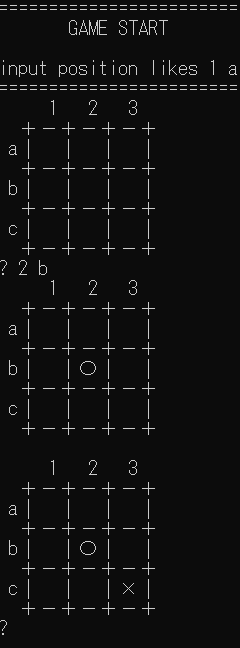

# 課題：強くして
本リポジトリのAIに対して、何らかの工夫をしてください！

* 計算を効率化する
* 新たなアルゴリズムを実装する

5目並べにすると、わかりやすいかもしれません。

# 工夫点

* 【行ったことをここに書く】
*Nega-Max法の実装
*Alpha-Beta法の実装
*モンテカルロ法の実装
*モンテカルロ法で残りマス数に応じてプレイアウト回数を調整する機能を実装(負荷が常に一定になるように)
*残りマス数が少なくなったらモンテカルロ法からAlpha-Beta法のAIに切り替えるようにしました。

# 取り組み方
* 本プロジェクトをforkして、取り組んでください。
* GitHub Actions (Actionsのタブ)を機能させて、README.mdに記述された下記のバッチの「tpu-game-2024」を自分のアカウントに差し替えてください。
* readme.md に実施した工夫を記載してください
* 可能であれば、速度等を計測して、具体的な効率化度合い、強さを示してください。
* 納得できるところまでできたところでプルリクを出してください。

（↑のソースコードの「tpu-game-2024」を自分のアカウント名に差し替えてください（２か所））
